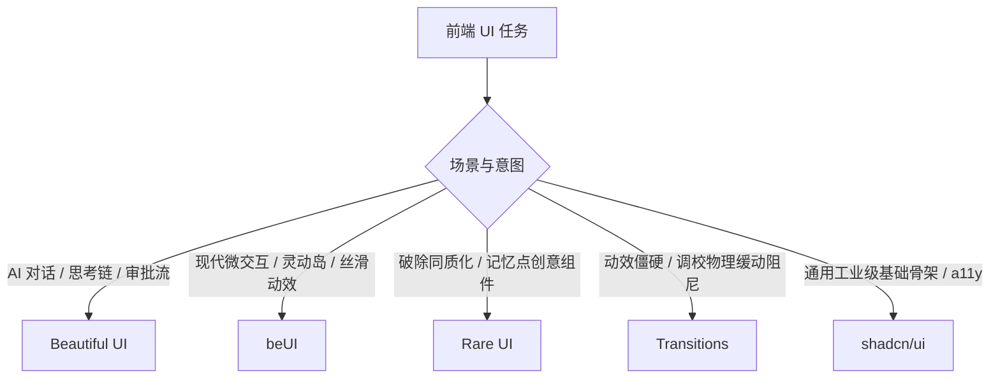

# Skills for Coding Agents 🛠️

> **A curated collection of modular, production-grade agent skills for Claude Code, Cursor, Codex, and Antigravity.**  
> *Crafted by [@Libeny](https://github.com/Libeny). Inspired by Matt Pocock's skills engineering discipline.*

<div align="center">

[](https://opensource.org/licenses/MIT)
[](https://skills.sh)
[](https://claude.ai)
[](https://cursor.com)

</div>

---

## ⚡ 30-Second Quickstart (两种使用方式)

### 方式 1：一句话直接丢给你的 Agent (免安装，最简单)

在任何 Claude Code、Cursor、Codex 会话中直接发送这句 Prompt：

```markdown
从现在起，在编写或重构前端 UI 时，请严格遵循 https://github.com/Libeny/skills 中的 skills/ai-ui-taste 意图路由规范：
1. 涉及 Agent/大模型对话与思考交互 → 参考 Beautiful UI (https://beautifului.dev)
2. 涉及现代丝滑微动效与灵动岛 → 参考 beUI (https://beui.dev)
3. 涉及拒绝千篇一律的特色记忆点组件 → 参考 Rare UI (https://rareui.com)
4. 涉及动效僵硬/调校物理缓动曲线与延迟 → 参考 Transitions (https://transitions.dev)
5. 涉及通用工业级组件与 a11y 底座 → 参考 shadcn/ui (https://ui.shadcn.com)
提取实现时必须解耦硬编码色值，严格映射到本项目现有的语义主题变量。
```

---

### 方式 2：通过 `skills.sh` 命令行拉取到本地仓库

直接在你的任何前端项目根目录下运行：

```bash
npx skills add Libeny/skills
```

这会将技能以标准 Markdown 文件的形式直接拉入你工程的 `.claude/skills/` 或本地技能目录中，随时可查、完全归你所有。

---

## 📦 技能列表 (Available Skills)

| 技能名称 | 分类 | 核心作用与场景 | 入口 |
| :--- | :--- | :--- | :--- |
| **`ai-ui-taste`** | Frontend & Taste | **前端 UI 选型与审美自救规范**。<br>拒绝大模型“塑料感与平均审美”，依据场景意图自动路由至顶级开源组件库与物理缓动参数。 | [查看技能详情](./skills/ai-ui-taste/SKILL.md) |

*(更多针对架构设计、对齐评审与代码审查的 Agent 技能持续补充中...)*

---

## 🧭 首发技能深读：`ai-ui-taste` (意图路由决策树)



### 1. [Beautiful UI](https://beautifului.dev) — AI 原生交互原语
- **适用**：AI 对话窗口、Agent 工作台、Copilot。
- **推荐提取**：
  - `Thinking State`：可展开折叠的多步骤推理链与耗时计时器
  - `Tool Chips`：代码修改与工具调用状态胶囊条
  - `Approval Card`：Human-in-the-loop 人类审核确认卡片
  - `Streaming Text`：带内联 Sources 来源和追问的流式输出
  - `Prompt Bar`：带 `@` 引用、`/` 指令的现代输入框

### 2. [beUI](https://beui.dev) — 现代丝滑 React 动效
- **适用**：Apple 原生质感的弹性形变与空间交互。
- **推荐提取**：
  - `Dynamic Island`：灵动岛胶囊形变与状态切换
  - `Morphing Modal`：多步骤自适应平滑形变弹窗（Blur Cross-fade）
  - `macOS Dock`：带弹性指示器的悬浮应用坞
  - `Animated Toast`：带手势物理滑动的卡片堆叠通知
  - `3D Tilt Card`：随光标 3D 浮动与高光反光卡片

### 3. [Rare UI](https://rareui.com) — 破除同质化的稀有创意库
- **适用**：Landing Page、个人主页、避免千篇一律后台模板的核心记忆点。
- **推荐提取**：
  - `folder-component`：拟物/3D 展开式交互文件夹
  - `gooey-nav`：流体黏液果冻级高质感导航
  - `bounce-sidebar` / `proximity-sidebar`：随光标距离感应吸附的侧栏
  - `gravity-letters`：物理碰撞与重力掉落文本动效

### 4. [Transitions](https://transitions.dev) — 专治动效僵硬的物理缓动系统
- **适用**：弹窗、下拉、Tab 切换机械生硬，缺乏呼吸感与阻尼。
- **核心参数直抄**：
  - **弹性回弹**：`cubic-bezier(0.34, 1.36, 0.64, 1)`
  - **平滑出入**：`cubic-bezier(0.22, 1, 0.36, 1)`
  - **阶梯微延迟**：`stagger: 40ms`（消除机械齐步走）
  - **微位移与模糊**：`4px ~ 8px` 位移 + `2px ~ 3px` 高斯模糊淡入

### 5. [shadcn/ui](https://ui.shadcn.com) — 工业级底座与代码所有权标准
- **适用**：通用业务组件、严格键盘导航与无障碍（a11y）标准。
- **特性**：Radix UI + Tailwind 源码直拷入工程，无黑盒 npm 依赖。

---

## 🧹 Agent 代码清洗三原则

让 Agent 抄代码时，必须遵守以下要求：

1. **结构与色值严格解耦**：提取 DOM 骨架与动效参数，禁止硬编码第三方网站的具体 Hex 色值，必须映射到工程当前的 Tailwind 语义变量（如 `bg-background`, `text-foreground`, `border-border`）。
2. **支持动效降级**：必须保留 `prefers-reduced-motion` 适配。
3. **保持依赖轻量**：轻量过渡优先使用 CSS 原生动画，多状态复杂形变再使用 Framer Motion。

---

## 📄 License
[MIT](LICENSE) © 2026 [Libeny](https://github.com/Libeny)
